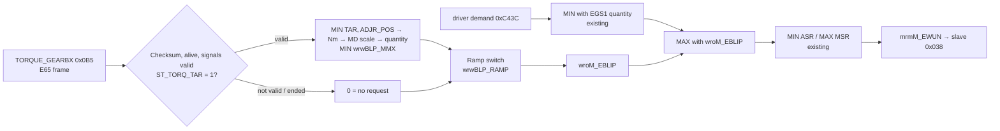

# Downshift blip for the M67 DDE4.1 with an 8HP and CANTCU (TORQUE_GEARBX approach)

This document specifies a **downshift blip** for the E38 740d (M67D39, DDE4.1 / Bosch EDC15C) after the 5HP30 has been replaced by a ZF 8HP controlled by **CANTCU** (CANformance Race+). The DDE4.1 gets the E65 DDE6.3 blip function: the transmission sends a torque request with "increase / decrease" semantics in a message on ID **0x0B5** (`TORQUE_GEARBX`), and the engine raises its torque to at least that value.

1. [Reference: the DDE6.3 blip function](#1-reference-the-dde63-blip-function)
2. [Starting point: the DDE4.1 today](#2-starting-point-the-dde41-today)
3. [Transport of the 0x0B5 request from CANTCU](#3-transport-of-the-0x0b5-request-from-cantcu)
4. [Function description: blip function for the DDE4.1](#4-function-description-blip-function-for-the-dde41)
5. [Implementation in the DDE41A master firmware](#5-implementation-in-the-dde41a-master-firmware)
6. [Test plan](#6-test-plan), [7. Open points](#7-open-points) and [8. Measurements](#8-measurements-parked-until-the-car-is-back)

Status: **design draft**. The DDE4.1 accepts the **real E65 `TORQUE_GEARBX` frame (0x0B5)** and validates it like the DDE6.3 does (checksum, alive counter, signal validity). The interim transport is a CANTCU User CAN Output with the same layout, which can't produce checksum and alive counter, so the DDE has a calibration switch for them. Sections 1-2 come from the static analysis in this repository. Sections 4-5 are a proposal and haven't been flashed or tested on a car. The patch builder (5.5) assembles and decodes cleanly, and its logic was run instruction by instruction against test frames (5.5).

Sources: [DDE63-RE/Function-Description-EGS-Torque-Intervention.md](DDE63-RE/Function-Description-EGS-Torque-Intervention.md), [DDE41A-RE/README.md](DDE41A-RE/README.md), [CANTCU-Installation.md](../E38-8HP-Conversion/CANTCU-Installation.md), [EDC15C function description](../Shared/Documentation/EDC15C-Function-Description/en/03-Fuel-Quantity-Control.md), CANformance wiki ([ECU list](https://wiki.canformance.net/CANTCU/integrations/supportedECUs), [E38/39/46/53/83](https://wiki.canformance.net/CANTCU/integrations/supportedECUs/bmwe394653), [E6/7/8/9x](https://wiki.canformance.net/CANTCU/integrations/supportedECUs/BMWE6789x), [User CAN Outputs](https://wiki.canformance.net/en/CANTCU/software/config/canoutputs), [Race+ configuration](https://wiki.canformance.net/CANTCU/software/race-plus/configuration)).

---

## 1. Reference: the DDE6.3 blip function

The E65 745d (DDE6.3, EDC16CP35) is the model. The full description is in [DDE63-RE/Function-Description-EGS-Torque-Intervention.md](DDE63-RE/Function-Description-EGS-Torque-Intervention.md).

| Step | DDE6.3 |
|---|---|
| Input | `TORQUE_GEARBX` 0x0B5 (10 ms): `TORQ_TAR_EGS` (target, 0.5 Nm), `ST_TORQ_TAR_EGS` (0 none, **1 increase**, 2 decrease, 3 invalid), `TORQ_TAR_ADJR_POS_EGS` (limit for the increase), checksum and alive counter |
| Validity | Checksum and alive correct, signals valid, `TORQ_TAR_ADJR_POS_EGS` ≠ 1000 Nm default |
| Increase request | min(`TORQ_TAR_EGS`, `TORQ_TAR_ADJR_POS_EGS`) |
| Ramp switch | While permitted, the request passes through unchanged and ends abruptly when the EGS drops it. 10 Nm per 20 ms ramp only when the DDE enables or withdraws the function |
| Coordinator | `min(demand + drag, gear limit)` → **`max(·, increase)`** → `min(·, further limit)` → `min(·, reduction)` |
| Calibration in the DDE | None for the blip itself. Amount, duration and which shifts get a blip come from the transmission |

The DDE4.1 version copies this chain: decode `TORQUE_GEARBX` → validity (checksum, alive counter, signals) → request evaluation → ramp switch → `max()` in the quantity coordinator, with the reduction keeping priority. A few DDE-side protections are added and can be switched off (4.3.1).

---

## 2. Starting point: the DDE4.1 today

From the master analysis ([DDE41A-RE/README.md](DDE41A-RE/README.md#transmission-egs-torque-intervention)):

| Item | DDE4.1 (`7787316O` / `Y7787646`) |
|---|---|
| Domain | **Fuel quantity** (0.01 mm³/stroke), not torque. Torques are converted with the specific consumption `mroBI_SOLL` (map 0xF21DE) |
| Transmission input | EGS1 0x43F, byte 3 `MD_IND_GS` (0xFF = no intervention) on on-chip CAN object 1 |
| Transmission intervention | `fn_0BB868`, 0x0BC4BA-0x0BC61A: EGS quantity = `MD_IND_GS` × `mroBI_SOLL` / 500 (`CALLS 0:10F2`); result = **min**(driver demand 0xC43C, EGS quantity) → 0xC43A |
| Afterwards | 0x0BC6B2: ASR (min), MSR (max) → 0xC0C2 → `fn_0B1148` → `mrmM_EWUN` |
| Torque increase from the transmission | **None** (§3.1.8.2: the EGS intervention "has a quantity-reducing effect") |
| Slave | Gets `mrmM_EWUN` in CANP frame 0x038 and follows automatically |
| Torque normalisation | `MD_NORM` in DDE2 0x329, multiplex `MUL_COD` = 3 (Nm/16 at 255) |
| Downstream limits | Limitation quantity `mrmM_EBEGR` (smoke, full load, protection, §3.1.9) |

The upshift reduction stays as it is (EGS1 from CANTCU's E38 integration). Only the **increase** path is new.

---

## 3. Transport of the 0x0B5 request from CANTCU

### Bus topology

With Race+, CANTCU uses its buses as follows:

- **CAN1:** the 8HP only (transmission pins 5/6). CAN2 isn't needed.
- **CAN3:** the car (here the former AGS pair to the master DDE, X2412 pins 3/4; see [CANTCU-Installation.md](../E38-8HP-Conversion/CANTCU-Installation.md#engine-control-can-topology)).
- **Shifter:** on CAN1 or CAN3, depending on the model.

The 8HP's own torque and blip requests travel on CAN1 and never reach the DDE. CANTCU translates them into the E38 integration messages (EGS1 0x43F) and a user CAN output, and both are sent on **CAN3**. The DDE4.1 therefore only has to receive the 0x0B5 frame on the bus it already uses for EGS1, which is the C167 on-chip CAN.

If the selected shifter is wired to CAN3, its frames also share the E38 bus. Its IDs must not collide with 0x0B5; check this when choosing the shifter.

### Why not the E6x integration

CANTCU's E6x integration sends the real E65 `TORQUE_GEARBX` 0x0B5, which the DDE6.3 uses for blips. On the E38 it doesn't work, because CANTCU runs one integration on CAN3:

- **No E38 messages.** EGS1 0x43F would disappear, and with it the IKE gear display, the DSC's gearbox information and the existing upshift reduction in the DDE.
- **No engine data for CANTCU.** CANTCU would expect the E65 engine messages (0x0A8/0x0A9/0x0AA torque, speed and pedal; 0x1D0 temperatures). The DDE4.1 sends DDE1/DDE2/DDE4 (0x316/0x329/0x545) instead. Emulating the E65 messages would require a second, much larger DDE patch.

### Recommended: the real E65 `TORQUE_GEARBX` frame on 0x0B5

The DDE4.1 receives the **E65 frame as it is**. The same frame is what CANTCU's E6x integration sends to every EDC16 DDE (E6x, E9x), and CANformance advised using a User CAN Output and not the Default CAN Datastream (the first plan, with Start ID 0x0B4 and frame Base+1 on 0x0B5). CANformance also confirmed that the request logic of CANTCU is already correct for this purpose and that the rates are fixed.

| Bit addr. | Bits | Signal | Scaling | In the DDE4.1 |
|---|---|---|---|---|
| 0 | 8 | `CHKSM_TORQ_EGS` | BMW checksum (below) | checked (*wcwBLP_CHK*) |
| 8 | 4 | `ALIV_TORQ_EGS` | counts 0..14, 0xF is never sent | checked (*wcwBLP_CHK*) |
| 12 | 12 | `TORQ_TAR_EGS` | 0.5 Nm, signed, 800H = invalid | request |
| 24 | 12 | `TORQ_TAR_ADJR_POS_EGS` | 0.5 Nm, signed, 800H = invalid, 1000 Nm (raw 2000) = default | limit for the increase |
| 36 | 2 | `ST_TORQ_TAR_EGS` | 0 none, **1 increase (blip)**, 2 decrease, 3 invalid | status |
| 40 / 46 | 4 / 2 | `ST_OBD_GRB`, `ST_LIM_STORQ` | | not used |
| 48 | 8 | `TORQ_DRAW_GRB` | 1 Nm | not used |
| 56 | 8 | `TEMP_GRB` | 1 °C, offset -40 | not used |

**Checksum.** `chk = fold8(Σ bytes 1..7 + 0xB5 + 0x00)`, with `fold8(s) = ((s & 0xFF) + (s >> 8)) & 0xFF` (the ID bytes are part of the sum), verified in the MK60E5 CAN analysis (an E92 log with about 49,000 frames) and again on the E65 logs below.

**Evidence from real E65 frames.** `Shared/CAN-Logs/E65` (two Vector logs of an E65 with Bosch DSC57) contain 62,534 frames of 0x0B5:

- every checksum matches the formula above;
- the alive counter counts +1 modulo 15 (0..14) in every transition within the two logs (62,532 of 62,532);
- the cycle is 10 ms;
- without intervention `TORQ_TAR_EGS` and `TORQ_TAR_ADJR_POS_EGS` are both 800H (invalid) and `ST_TORQ_TAR_EGS` = 0;
- in 18-50 % of the frames `ST_TORQ_TAR_EGS` = 2 with target and limit equal (a maximum torque limit). The DDE4.1 ignores status 2, because the reduction comes via EGS1;
- there are **no** `ST_TORQ_TAR_EGS` = 1 frames, so the blip semantics still rest on the DDE6.3 analysis.

**CANTCU.** The E6x integration can't be used on the E38 as it is (it would replace the E38 messages, see above). Two ways to get the real frame onto the bus next to the E38 integration:

1. **Add-on integration** (target solution). CANformance offered to discuss a separate integration that sends the protected 0x0B5, especially if it is useful for other EDC15 users. The DDE then runs with *wcwBLP_CHK* = 1 and nothing but the standard BMW checks.
2. **User CAN Output** (interim, [User CAN Outputs](https://wiki.canformance.net/en/CANTCU/software/config/canoutputs)). Up to 4 user messages on CAN3; per message the CAN ID, DLC 1-8, cycle (10, 20, 100 or 1000 ms) and up to 16 signals with variable, start bit, length, byte order, signed, factor and offset, or a static hex value. One message with **ID 0x0B5, DLC 8, 10 ms** carries:

| Signal | Output setting |
|---|---|
| `TORQ_TAR_EGS` (bit 12, 12 bit, signed) | `Target Torque`, factor 2 (0.5 Nm per bit); unit to confirm |
| `TORQ_TAR_ADJR_POS_EGS` (bit 24, 12 bit) | static hex value = the limit, for example `4B0` (600 Nm). Not `7D0` (the default) and not `800` |
| `ST_TORQ_TAR_EGS` (bit 36, 2 bit) | `TCU Intervention` (0 none, 1 blip = increase, 2 shiftcut = decrease) |
| `CHKSM_TORQ_EGS`, `ALIV_TORQ_EGS` | **can't be generated** (static `00`) |
| the rest | static `00` |

With the user output the DDE needs *wcwBLP_CHK* = 0, and the extra checks in 4.3.1 are the only protection against a stuck or wrong frame. A static limit also gives the DDE the same upper limit as the E65's `TORQ_TAR_ADJR_POS_EGS`.

**Is 0x0B5 free on the E38 vehicle CAN?** Nothing found in the available documents uses it:

- The DDE4.1 master receives 0x43F, 0x615, 0x153, 0x613 and 0x52C and transmits 0x316, 0x329 and 0x545 (CAN objects in the calibration, see [DDE41A-RE/README.md](DDE41A-RE/README.md)).
- The Bosch EDC15C function description (9.2.4, BMW CAN specification 11H Rev. 1.5) lists the messages the DDE exchanges: ASC1 0x153, ASC3 0x1F3, EGS1 0x43F, DDE1 0x316, DDE2 0x329, DDE4 0x545, DDE8 0x338, INSTR2 0x613, TXU1 0x445 and INSTR3 0x615. The DSC's torque requests and its data from the DDE are all in that set. A/C compressor data (`S_KO`, `S_AC`, `LM_KK` in 0x615, `S_KOREL` in 0x316) and the ACC acknowledgements (`Q_ACC_DME` in 0x329, `Q_ACC_BAS` in 0x1F3) are signals inside these frames, not extra IDs.
- The frame catalogue of the E38 750i's M73 powertrain CAN (a separate project) has no 0x0B5 either.
- A scan of the E38 SP-Daten engine control unit data for CAN object records with ID 0x0B5 found none. The SGBDs contain no ID tables.

This isn't proof for traffic that the DDE doesn't see (for example the messages of Active Cruise Control to the DSC, if the car has it), and there are no E38 CAN logs. The baseline log (test plan step 1) has to confirm that 0x0B5 is absent from the stock bus. The ID is free to choose, so a different one works too (the descriptor in 5.3 changes accordingly). One 8-byte frame every 10 ms adds about 2.6 % bus load at 500 kbit/s.

| | E65 `TORQUE_GEARBX` (real) | User output on 0x0B5 (interim) |
|---|---|---|
| Rate | 10 ms | 10 ms |
| Layout and scaling | as above | same bits; target and status from CANTCU, limit static |
| Increase / decrease | `ST_TORQ_TAR_EGS` 1 / 2 | `TCU Intervention` 1 / 2 |
| Limit for the increase | `TORQ_TAR_ADJR_POS_EGS` | static value in the output |
| Integrity | checksum + alive counter | **none** (CANformance: the user can't add one) → *wcwBLP_CHK* = 0, CAN CRC plus the switchable extra checks in the DDE (4.3.1) |

**To confirm with a CAN log** (CANTCU E38 integration + user output, manual downshifts):

- `Target Torque` carries the blip target while `TCU Intervention` = 1, rather than for example the pre-shift torque, and its unit and scaling.
- That EGS1 `S_SCHALT` and `GANG_INF` precede the request, and that `MD_IND_GS` stays 0xFF during a downshift blip (CANformance hasn't answered this yet). This decides whether the extra check E2 can be switched on.
- Which variables exist for the user output, and what the frame contains while CANTCU or the transmission is in a fault or limp state.
- `MD_NORM` from DDE2 0x329 (`MUL_COD` = 3), for *wrwBLP_MDN*.
- 0x0B5 absent from the stock bus before the output is enabled, and no DSC/IKE faults with the extra frame on the bus.

### CANTCU configuration for the M67

The blip only fires on downshifts that CANTCU decides to make, so the CANTCU settings define the blip range. All of them are engine-specific, and the stock values are for petrol engines:

- **RPM Limits** (Race+ configuration, Transmission): `Idle RPM`, `Max RPM` and `Downshift RPM` (screenshot defaults: 800 / 5000 / 2000). Set them for the M67 and to the same values used when Race+ was flashed with the 8HP TCM tool. Wrong values give unexpected shifting.
- **Auto-upshift in Manual:** the rpm (default 6800) is configurable and has to be set for the diesel.
- **Shift maps** (Drive and Sport), rpm over pedal position. The maps aren't set up automatically. *Generate* creates a complete starting map from *Minimum shift RPM* (upshift at 0 % pedal; defaults 1500 Drive / 2000 Sport) and *Maximum shift RPM* (upshift at 100 % pedal and kickdown; defaults 6500 / 7000). Downshift points are calculated from the gear ratios. Then tune by hand or with Autolearn. A red cell pair means an upshift and downshift point too close together for that gear pair and pedal position (the gearbox would hunt): raise the upshift or lower the downshift rpm until nothing is red. Holding the Spacebar shows the engine speed after the shift.
- **Predictive downshifts** (Sport): *Maximum RPM increase* (35 %) limits how far a predicted downshift raises the engine speed.

The engine speed after a downshift (the Spacebar view) is what the blip has to reach, so tuning the maps also changes the blip size. **`wrwBLP_NMX` is derived from the final maps:** highest engine speed after any permitted downshift plus a margin, but below the governed engine speed of the M67 and not below `Max RPM`. CANTCU's `Max RPM` limits the shift decision only. It isn't a limit on the request and doesn't replace the DDE ceiling (E3, 4.3.1).

---

## 4. Function description: blip function for the DDE4.1

Written like §3.1.8 of the EDC15C function description. New messages and labels are **working names** (prefix `w`). The CAN signal names are those of the E65 0x0B5.

### 4.1 Overview

The external quantity intervention (§3.1.8) gets an additional, **quantity-increasing** EGS intervention *wroM_EBLIP*. It is inserted after the minimum selection with the EGS1 quantity and before the ASR intervention:

```text
mroM_EXGS   = MD_IND_GS × mroBI_SOLL                (existing, EGS1 upshift reduction)
x           = MIN(driver demand, mroM_EXGS)          (existing, 0xC43A)
x           = MAX(x, wroM_EBLIP)                     NEW: TORQUE_GEARBX increase (blip)
x           = MIN(x, mroM_EASR)                      (existing, ASR keeps priority)
...         = MAX(x, mroM_EMSR) -> mrmM_EWUN          (existing, to slave in CANP 0x038)
```

This is the DDE6.3 order (`min(gear limit)` → `max(increase)` → further limits) in the quantity domain. The reduction gets priority by suppressing the blip while EGS1 reduces (4.3, condition 4).



Figure 4-1: WBLIP01, `TORQUE_GEARBX` increase intervention in the external quantity intervention

### 4.2 Receiving TORQUE_GEARBX

| CAN message: TORQUE_GEARBX | | Identifier: 0B5H | | | |
|---|---|---|---|---|---|
| Signal | Designation | Bit addr. | Bit count | Default | Message (working name) |
| `CHKSM_TORQ_EGS` | Checksum | 0 | 8 | | checked in the receive step |
| `ALIV_TORQ_EGS` | Alive counter | 8 | 4 | | checked in the receive step |
| `TORQ_TAR_EGS` | Torque target, 0.5 Nm, 800H = invalid | 12 | 12 | 0 | *wroBLP_MTAR* |
| `TORQ_TAR_ADJR_POS_EGS` | Limit for the increase, 0.5 Nm, 800H = invalid | 24 | 12 | 0 | *wroBLP_MADJ* |
| `ST_TORQ_TAR_EGS` | Status of the torque target | 36 | 2 | 0 | *wroBLP_ST* |

Received on on-chip CAN object 9 with the same receive handler as EGS1 (`sub_097E8E`). After *wcwBLP_TOUT* task cycles without a new message, the buffer is filled with the default data (all 0 = no intervention) and status bit 2 is set.

**Request torque.** As in the DDE6.3, the request is only evaluated for `ST_TORQ_TAR_EGS` = 1. `TORQ_TAR_EGS` and `TORQ_TAR_ADJR_POS_EGS` must not be invalid (800H) or negative, and the limit must differ from its default *wrwBLP_ADJD* (raw 2000 = 1000 Nm). Otherwise there is no request. For a valid request:

*wroBLP_MREQ* (Nm) = MIN(*wroBLP_MTAR*, *wroBLP_MADJ*) / 2

**Torque to quantity.** The DDE4.1 computes intervention quantities from the 8-bit torque scale of `MD_IND_GS` (% of `MD_NORM`, 255 = 16 × `MD_NORM` Nm). The request is first converted to that scale and then with the existing conversion:

*wroBLP_MDR* = MIN(*wroBLP_MREQ* × 255 / *wrwBLP_MDN*, 254), with *wrwBLP_MDN* = 16 × `MD_NORM` in Nm

*wroM_EBLPR* = MIN(*wroBLP_MDR* × `mroBI_SOLL` / 500, *wrwBLP_MMX*)

### 4.3 Request evaluation

Like the ASR/MSR intervention (§3.1.8.3/3.1.8.4), the increase intervention is only recognised as valid if all of these hold. Otherwise *wroM_EBLIP* goes to the neutral value 0.

1. The function is enabled (*wcwFUN_BLP* = 1).
2. **Message present and BMW checks:** the receive status shows no default data (status bit 2 = 0), and, if *wcwBLP_CHK* = 1, checksum and alive counter are correct (4.3.1).
3. **Request:** *wroBLP_ST* = 1 (increase; 2 = decrease is ignored because the reduction comes via EGS1), target and limit valid, *wroBLP_MREQ* > 0.
4. **Reduction has priority:** EGS1 isn't missing (*fbeEEGS_F* = 0) and isn't reducing (`MD_IND_GS` = 0xFF).
5. **Operating window:** `dzmNmit` ≥ *wrwBLP_NMN*, `anmWTF` ≥ *wrwBLP_TMN*, `fgmFGAKT` ≥ *wrwBLP_VMN*. The upper engine speed limit *wrwBLP_NMX* is the ceiling E3 (4.3.1).
6. **Maximum duration** (last-resort protection against a stuck request): a counter *wroBLP_T* runs while the request is present. If it reaches *wrwBLP_TMX*, the request is ignored until *wroBLP_ST* has been 0 at least once (status 4). After *wrwBLP_LOCK* such events in one driving cycle, the function stays off until terminal 15 off (status 8).
7. **Extra protections** E2 and E3 (4.3.1) pass.

#### 4.3.1 Integrity: BMW checks and extra protections

**BMW checks (as in the DDE6.3).** The E65 EGS protects 0x0B5 with a checksum and an alive counter, and the DDE6.3 checks both (fault path 0xC3) together with the validity of the signals. The DDE4.1 does the same, so a sender that follows the BMW protocol (the E65 EGS, CANTCU's E6x integration, a future CANformance add-on) needs nothing else:

- **Checksum:** `fold8(Σ bytes 1..7 + 0xB5)` must equal byte 0 (3).
- **Alive counter:** the nibble must not be 0xF, and it must change. The task period of the DDE isn't the 10 ms frame period, so the DDE doesn't require a +1 step, only a change within *wrwBLP_ALVN* polls.
- **Signal validity:** 800H and the default limit are rejected (4.2).
- **Failure:** a failure that persists for *wrwBLP_EDEB* polls counts as an integrity error (status 64). *wrwBLP_EMX* errors in one driving cycle lock the function until terminal 15 off.
- **Switch:** *wcwBLP_CHK* = 0 skips checksum and alive counter. It is needed while the sender can't generate them (the CANTCU user output).

| Fault | Covered by |
|---|---|
| Bit errors on the wire | **CAN controller CRC-15**, already in hardware; corrupted frames are discarded |
| Frame from the wrong sender | ID 0x0B5 isn't used by any other node on the E38 bus |
| Message missing | Receive timeout (condition 2) |
| Frozen or stale frame | Alive counter (BMW); without it: maximum duration (condition 6) and E2 |
| Wrong request (software or configuration fault) | Checksum and signal validity (BMW); without them: E2 and E3 |

**Extra protections.** These aren't part of the BMW protocol. They cost no CAN data, and each can be switched off or set out of range in the calibration, so the function can be brought as close to the DDE6.3 as the sender allows. Recommended: keep E3 and the maximum duration always on, and use E2 while the sender has no checksum and alive counter and once the log shows the EGS1 timing. (A torque echo check E1 from an earlier draft, which needed the engine torque in the frame, was dropped when the frame was changed to the E65 layout; E2 and E3 keep their names.)

**E2: confirmation by EGS1 (second, independent message; *wcwBLP_XEGS* = 1).** The request must agree with the E38 integration message EGS1 0x43F, which CANTCU builds by a separate path:

- EGS1 `S_SCHALT` (shift active) = 1;
- EGS1 `GANG_INF` (target gear) is lower than the gear latched before the shift (downshift);
- EGS1 `MD_IND_GS` = 0xFF (no reduction, already condition 4).

The request must also **start** (rising edge of `ST_TORQ_TAR_EGS` = 1) within *wrwBLP_TARM* after `S_SCHALT` rises. The blip ends at the latest when `S_SCHALT` falls, whatever the frame says. A stuck 0x0B5 frame alone therefore can't create a blip or keep one running. It is off by default, because the assumption that EGS1 leads the request is still to be confirmed by log (3).

**E3: engine speed ceiling (always on; *wrwBLP_NMX*).** As soon as `dzmNmit` ≥ *wrwBLP_NMX*, *wroM_EBLIP* is set to 0 immediately (status 128), and no blip starts at or above it. This is a fixed calibration that doesn't depend on CANTCU. *wrwBLP_NMX* is derived from CANTCU's `Max RPM` and the tuned shift maps (3, "CANTCU configuration for the M67"). CANTCU's own `Max RPM` already keeps its downshift decisions inside the engine's range, so the transmission's target-gear speed isn't needed by the DDE.

Even with a completely wrong torque request, the engine can't be raised above *wrwBLP_NMX*. Below it, the blip is limited by *wrwBLP_MMX* (the DDE6.3 equivalent is `wGbxIf_Par+0x50`), by the limit in the frame and by *wrwBLP_TMX*. The ceiling doesn't follow the target gear speed of the individual shift.

All checks use only 0x0B5 and the existing EGS1 object, so only one additional on-chip CAN object is needed (5.1, 5.3).

### 4.4 Ramp switch

As in the DDE6.3 (`fn_45AD50`, FId 0xC7):

- **While permitted** (conditions 1, 2, 4, 5 met): *wroM_EBLIP* = *wroM_EBLPR* if a request is present (condition 3), with no ramp or filter. The shape of the blip comes entirely from CANTCU.
- **When the request ends** (*wroBLP_ST* ≠ 1): *wroM_EBLIP* = 0 immediately (abrupt end).
- **When the permission is withdrawn during a request** (timeout, reduction from EGS1, operating window left, maximum duration): *wroM_EBLIP* ramps to 0 with *wrwBLP_RAMP* per call (status 2).

### 4.5 Interaction with other functions

- **ASR/MSR:** the blip comes before the ASR minimum, so traction control can always cut it. MSR stays a `max()` after it.
- **Limitation quantity:** `mrmM_EBEGR` (smoke, full load, turbocharger protection) applies downstream and also limits the blip.
- **Overrun fuel cut-off (§3.1.4):** the blip raises the desired quantity above 0, so the cut-off logic sees a demand. To verify on the car.
- **Active surge damper (§3.1.12):** during shifts (`S_SCHALT` in EGS1) the ARD uses its shift parameter set `mrwARDS_I`.
- **Torque feedback:** DDE1 `MD_IND_NE` (`mroMD_SOLL`) contains the result after the interventions, so CANTCU sees the torque rise.
- **Slave:** unchanged; it receives the raised `mrmM_EWUN` in CANP 0x038.

### 4.6 Status

| wroBLPSTAT | Meaning |
|---|---|
| 1 | Increase intervention active (*wroM_EBLIP* > 0) |
| 2 | Ramp *wrwBLP_RAMP* active (permission withdrawn) |
| 4 | Maximum duration *wrwBLP_TMX* reached, waiting for the request to drop |
| 8 | Function locked until terminal 15 off (*wrwBLP_LOCK* reached) |
| 16 | Request present but outside the operating window, or EGS1 reducing |
| 32 | `TORQUE_GEARBX` missing (default data) |
| 64 | Integrity error: checksum or alive counter (BMW checks), or E2; lock after *wrwBLP_EMX* errors |
| 128 | Engine speed ceiling reached (E3), blip cut |

### 4.7 Messages and parameters

**Inputs:** `dzmNmit` (0xC0A8), `anmWTF` (0xC086), `fgmFGAKT` (0xC0A0), `mroBI_SOLL` (0xC40A, task-local in `fn_0BB868`), `MD_IND_GS` (EGS1 copy via pointer 0xD656), quantity after the EGS minimum (0xC43A).

**New RAM:** *wroBLP_MTAR*, *wroBLP_MADJ*, *wroBLP_ST*, *wroBLP_MREQ*, *wroBLP_MDR*, *wroM_EBLPR*, *wroM_EBLIP*, *wroBLP_T*, *wroBLP_NLOCK*, *wroBLPSTAT*, plus the alive and E2 state bytes (5.4).

**New calibration** (block at 0xF7880, section 5.4):

| Offset | Label | Meaning | Unit | Start value |
|---|---|---|---|---|
| +0x00 | *wcwFUN_BLP* | Function switch | 0/1 | 0 (off until tested) |
| +0x02 | *wrwBLP_NMN* | Minimum engine speed | rpm | 900 |
| +0x04 | *wrwBLP_NMX* | Engine speed ceiling (E3), derived from `Max RPM` and the tuned shift maps | rpm | 3800 (placeholder) |
| +0x06 | *wrwBLP_TMN* | Minimum coolant temperature | `anmWTF` raw | ≙ 60 °C |
| +0x08 | *wrwBLP_VMN* | Minimum vehicle speed | 0.01 km/h | 500 |
| +0x0A | *wrwBLP_MMX* | Maximum blip quantity (DDE6.3: `wGbxIf_Par+0x50`, not capped there) | 0.01 mm³ | 3000 (start low) |
| +0x0C | *wrwBLP_TMX* | Maximum blip duration (extra protection) | task cycles | ≙ 600 ms |
| +0x0E | *wrwBLP_RAMP* | Ramp step when withdrawn (DDE6.3: 10 Nm per 20 ms) | 0.01 mm³ per call | 200 (as *mrwEGSRAMP*) |
| +0x10 | *wrwBLP_MDN* | 16 × `MD_NORM` | Nm | from DDE2 log |
| +0x12 | *wrwBLP_LOCK* | Duration events until lock | | 3 |
| +0x14 | *wrwBLP_ADJD* | Default value of `TORQ_TAR_ADJR_POS_EGS` (not a request) | 0.5 Nm | 2000 (1000 Nm) |
| +0x16 | *wcwBLP_CHK* | Check checksum and alive counter (BMW) | 0/1 | 1 (0 for the CANTCU user output) |
| +0x18 | *wrwBLP_ALVN* | Polls with an unchanged alive counter until fault | task cycles | 5 |
| +0x1A | *wcwBLP_XEGS* | Extra check E2: EGS1 confirms a downshift | 0/1 | 0 (until the log confirms the timing) |
| +0x1C | *wrwBLP_TARM* | E2: window after `S_SCHALT` rising in which the request may start | task cycles | ≙ 300 ms |
| +0x1E | *wrwBLP_EDEB* | Debounce of integrity failures | task cycles | 3 |
| +0x20 | *wrwBLP_EMX* | Integrity errors until lock | | 3 |
| +0x80 | *wcwBLP_CAN* | Receive descriptor (5.3) | | |

---

## 5. Implementation in the DDE41A master firmware

Only the **master** (`7787316O.0PA` program + `Y7787646.0DA` data) is changed. The slave stays stock.

### 5.1 Free resources

| Resource | Where | Evidence |
|---|---|---|
| Program code | **0x0C0000-0x0DFEFF** (128 KB) | 0xFF in the `.0PA` and the full flash read; last application byte at 0x0BD15A. Covered by the program file and erased by `FLASH_LOESCHEN` |
| Calibration | **0x0F7846-0x0F7FFF** (1978 bytes, C3 filler) | After the last label; reachable as 16-bit 0x7846-0x7FFF through DPP1 (0x3D) |
| RAM | **0xE780-0xE7DF** (XRAM, proposal) | No direct or immediate reference in the application. The top-sector flash drivers use 0xE000-0xE5FF only in programming mode. Not provable statically (segment-0 ROM and stack are invisible) → bench check (5.7) |
| CAN | On-chip CAN **object 9** (0xEF90): 0x0B5 (objects 10 and 11 stay free) | Objects 1-8 used; `sub_097BCA` resets all 15 |

### 5.2 Hooks

Three 4-byte `CALLS` replacements. In each case the replaced instruction is executed inside the patch.

| # | Address | Original | Replaced by | Purpose |
|---|---|---|---|---|
| H1 | 0x099858 (`sub_099802`) | `DA 09 E0 7B` `CALLS 0x097BE0` | `DA 0C 00 00` `CALLS 0x0C0000` | Configure object 9 (0x0B5), then `sub_097BE0` |
| H2 | 0x097FA8 (`fn_097F10`) | `DA 09 8E 7E` `CALLS 0x097E8E` | `DA 0C 00 01` `CALLS 0x0C0100` | Receive object 5 as before, then object 9 |
| H3 | 0x0BC61C (`fn_0BB868`) | `F3 F8 80 C4` `MOVB RL4, 0xC480` | `DA 0C 00 02` `CALLS 0x0C0200` | Blip function after the EGS minimum, then `MOVB RL4, 0xC480` |

Register rules observed in the original code:

- In `fn_0BB868`, `R0` is a frame pointer (`[R0+#n]`) and must not change.
- After H3 the code reloads R1-R5 itself.
- After H2 the caller stores `RL7`/`R9` (object 5 state), so the patch must return them unchanged.
- `sub_099802` uses `R0` as the descriptor argument for `sub_097C14` and doesn't need it after H1.

### 5.3 CAN receive descriptor

At 0xF7900 (16-bit 0x7900, DPP1), same 16-byte layout as the EGS1 descriptor at 0xF1F80 (`01 32 01 00 06 00 00 FF 00 00 00 10 08 87 E0 80`):

| Offset | Value | Meaning |
|---|---|---|
| +0x00 | `01` | Reload of the poll counter (`RL7`) |
| +0x01 | *wcwBLP_TOUT* | Timeout in task cycles. Set to about 3 periods of the 10 ms user output (30 ms) once the task period is known; EGS1 uses 0x32 |
| +0x02 | `01` | Use default data on timeout |
| +0x03-0x0A | `00 00 00 00 00 00 00 00` | Default data: no intervention (`ST_TORQ_TAR_EGS` = 0) |
| +0x0B | `90` | Object 9 (0xEF90) |
| +0x0C | `08` | Length |
| +0x0D-0x0E | `16 A0` | Arbitration 0x0B5 << 5 (for another ID: ID << 5) |
| +0x0F | `80` | DLC 8, receive |

There is no second or third descriptor: the checks need only this frame and EGS1.

### 5.4 New code (C167 assembly, draft)

Conventions as in the listing: DPP0 = 0x3C (0xF0000), DPP1 = 0x3D (0xF4000), DPP3 = RAM/SFR. Calibration block `BLP_CAL` at 16-bit 0x7880 (→ 0xF7880). RAM at 0xE780. `CALLS 0:10F2` is the multiply/divide routine of the EGS block (R4 = R12 × R13 / R14).

```asm
; ---------------- RAM (XRAM, proposal) ----------------
BLP_RXBUF   EQU 0E780h   ; 9 bytes: TORQUE_GEARBX 0x0B5 + status (filled by sub_097E8E)
                         ;  +0 CHKSM  +1 ALIV (bits 0-3) / TORQ_TAR bits 0-3 (4-7)  +2 TORQ_TAR bits 4-11
                         ;  +3 ADJR_POS bits 0-7  +4 ADJR_POS bits 8-11 / ST_TORQ_TAR (bits 4-5)
                         ;  +5..+7 not used  +8 receive status
BLP_RXCNT   EQU 0E78Ah   ; byte: poll counter (RL7)
BLP_RXTIM   EQU 0E78Ch   ; word: receive time stamp (R9)
BLP_STAT    EQU 0E78Eh   ; byte: wroBLPSTAT
BLP_NLOCK   EQU 0E78Fh   ; byte: duration events in this driving cycle
BLP_QREQ    EQU 0E790h   ; word: wroM_EBLPR
BLP_Q       EQU 0E792h   ; word: wroM_EBLIP
BLP_T       EQU 0E794h   ; word: wroBLP_T
BLP_TOLOCK  EQU 0E796h   ; byte: 1 = duration exceeded, wait for request drop
BLP_INIT    EQU 0E798h   ; word: 0x5AA5 when initialised

; ---------------- calibration (DPP1) ----------------
BLP_CAL     EQU 07880h   ; layout in 4.7
BLP_DESC    EQU 07900h   ; CAN descriptor (5.3)

; ===== H1: 0x0C0000, end of sub_099802 (CAN init) =====
blp_can_init:
        MOV     R0, #BLP_DESC
        CALLS   09h, 7C14h           ; configure object 9 like objects 1-8
        MOVB    RL1, BLP_DESC        ; poll counter reload
        MOVB    BLP_RXCNT, RL1
        MOV     R1, 0F940h           ; time base, as in loc_097E20
        MOV     BLP_RXTIM, R1
        MOV     BLP_T, ZEROS
        MOV     BLP_Q, ZEROS
        MOVB    BLP_TOLOCK, ZEROS
        MOVB    BLP_NLOCK, ZEROS     ; init runs after power-up -> per driving cycle
        MOV     R1, #5AA5h
        MOV     BLP_INIT, R1
        CALLS   09h, 7BE0h           ; original instruction
        RETS

; ===== H2: 0x0C0040, fn_097F10 (receive task) =====
blp_can_rx:
        CALLS   09h, 7E8Eh           ; object 5 (original)
        PUSH    R7
        PUSH    R9
        MOV     R4, BLP_INIT
        CMP     R4, #5AA5h
        JMPR    cc_NZ, rx_done
        MOV     R6, #BLP_DESC
        MOV     R1, #BLP_RXBUF
        MOVB    RL7, BLP_RXCNT
        MOV     R9, BLP_RXTIM
        CALLS   09h, 7E8Eh           ; object 9 (0x0B5), same handler as EGS1
        MOVB    BLP_RXCNT, RL7
        MOV     BLP_RXTIM, R9
rx_done:
        POP     R9
        POP     R7
        RETS

; ===== H3: 0x0C0100, fn_0BB868 at 0x0BC61C =====
; in : 0xC43A = quantity after the EGS1 minimum, 0xC40A = mroBI_SOLL
; out: 0xC43A = MAX(0xC43A, wroM_EBLIP)
blp_main:
        PUSH    R6
        PUSH    R7
        MOVB    RL7, #0                  ; new status
        MOV     R4, BLP_INIT
        CMP     R4, #5AA5h
        JMPR    cc_NZ, blp_off
        MOV     R4, BLP_CAL              ; 1. wcwFUN_BLP
        CMP     R4, #0
        JMPR    cc_Z, blp_off
        MOVB    RL4, BLP_NLOCK           ;    driving-cycle lock
        CMPB    RL4, BLP_CAL+12h         ; wrwBLP_LOCK
        JMPR    cc_UGE, blp_locked
        ; --- 2. message present ---
        MOVB    RL4, BLP_RXBUF+8
        JB      R4.2, blp_missing
        ; --- 2a. BMW checksum and alive counter (wcwBLP_CHK) ---
        MOV     R4, BLP_CAL+16h
        CMP     R4, #0
        JMPR    cc_Z, chk_done
        MOV     R4, #0B5h                ; ID low byte, high byte is 0
        MOVBZ   R1, BLP_RXBUF+1          ; ADD of bytes 2..7 follows the same pattern
        ADD     R4, R1
        MOV     R2, R4
        MOV     R1, #8
        ASHR    R2, R1                   ; carry byte
        AND     R4, #00FFh
        ADD     R4, R2
        AND     R4, #00FFh               ; fold8
        MOVBZ   R1, BLP_RXBUF
        CMP     R4, R1
        JMPR    cc_NZ, blp_chkfail
        MOVBZ   R4, BLP_RXBUF+1
        AND     R4, #000Fh               ; ALIV_TORQ_EGS
        CMP     R4, #0Fh
        JMPR    cc_Z, blp_chkfail        ; 0xF is never sent
        MOVBZ   R1, BLP_ALVPREV
        CMP     R4, R1
        JMPR    cc_Z, alv_same
        MOVB    BLP_ALVPREV, RL4         ; counter moved: restart
        MOVB    BLP_ALVCNT, ZEROS
        JMPR    cc_UC, chk_done
alv_same:
        MOVBZ   R4, BLP_ALVCNT
        ADD     R4, #1
        MOVB    BLP_ALVCNT, RL4
        CMP     R4, BLP_CAL+18h          ; wrwBLP_ALVN
        JMPR    cc_UGT, blp_chkfail
chk_done:
        MOVB    BLP_EDEB2, ZEROS
        ; --- 3. request: ST_TORQ_TAR_EGS = 1, as in the DDE6.3 ---
        MOVBZ   R4, BLP_RXBUF+4
        AND     R4, #0030h
        MOV     R1, #4
        ASHR    R4, R1                   ; R4 = ST_TORQ_TAR_EGS
        MOVBZ   R2, BLP_STPREV
        MOVB    BLP_STOLD, RL2           ; previous status, for E2
        MOVB    BLP_STPREV, RL4
        CMP     R4, #1
        JMPR    cc_NZ, blp_norq          ; 0, 2 (decrease) and 3: no request
        MOVBZ   R6, BLP_RXBUF+2          ; TORQ_TAR_EGS = byte 2 x 16 + byte 1 high nibble
        MOV     R1, #16
        MULU    R6, R1
        MOV     R6, MDL
        MOVBZ   R1, BLP_RXBUF+1
        MOV     R2, #4
        ASHR    R1, R2
        ADD     R6, R1
        CMP     R6, #0800h
        JMPR    cc_UGE, blp_norq         ; 800H = invalid, above = negative
        MOVBZ   R1, BLP_RXBUF+4          ; TORQ_TAR_ADJR_POS_EGS = byte 4 low nibble x 256 + byte 3
        AND     R1, #000Fh
        MOV     R2, #256
        MULU    R1, R2
        MOV     R1, MDL
        MOVBZ   R2, BLP_RXBUF+3
        ADD     R1, R2
        CMP     R1, #0800h
        JMPR    cc_UGE, blp_norq
        CMP     R1, BLP_CAL+14h          ; wrwBLP_ADJD: default = no request
        JMPR    cc_Z, blp_norq
        CMP     R6, R1
        JMPR    cc_ULE, rq_min
        MOV     R6, R1                   ; MIN(target, limit)
rq_min:
        MOV     R1, #1
        ASHR    R6, R1                   ; 0.5 Nm -> Nm
        CMP     R6, #0
        JMPR    cc_SLE, blp_norq
blp_have_tq:
        MOV     R12, R6                  ; request [Nm] for the conversion below (capped at 2000 Nm in the build)
        ; --- 4. EGS1 reduction has priority ---
        MOV     R5, 0D656h               ; pointer to the EGS1 copy (fn_0BB608)
        MOVB    RL5, [R5+#3]             ; MD_IND_GS
        CMPB    RL5, #0FFh
        JMPR    cc_NZ, blp_window
        ; --- 5. operating window ---
        MOV     R5, 0C0A8h               ; dzmNmit
        CMP     R5, BLP_CAL+2
        JMPR    cc_ULT, blp_window
        MOV     R5, 0C086h               ; anmWTF
        CMP     R5, BLP_CAL+6
        JMPR    cc_SLT, blp_window
        MOV     R5, 0C0A0h               ; fgmFGAKT
        CMP     R5, BLP_CAL+8
        JMPR    cc_ULT, blp_window
        ; --- 6. maximum duration ---
        MOVB    RL4, BLP_TOLOCK
        CMPB    RL4, #0
        JMPR    cc_NZ, blp_tmo_wait
        MOV     R5, BLP_T
        CMP     R5, BLP_CAL+0Ch
        JMPR    cc_UGE, blp_timeout
        ADD     R5, #1
        MOV     BLP_T, R5
        ; --- torque [Nm] -> MD scale -> quantity ---
        MOV     R13, #255
        MOV     R14, BLP_CAL+10h         ; wrwBLP_MDN = 16 x MD_NORM
        CALLS   00h, 10F2h               ; R4 = Nm x 255 / MDN
        CMP     R4, #254
        JMPR    cc_ULE, blp_md_ok
        MOV     R4, #254
blp_md_ok:
        MOV     R12, R4
        MOV     R13, 0C40Ah              ; mroBI_SOLL (task-local, valid here)
        MOV     R14, #01F4h              ; 500, as in the EGS1 conversion
        CALLS   00h, 10F2h
        CMP     R4, BLP_CAL+0Ah          ; wrwBLP_MMX
        JMPR    cc_SLE, blp_q_ok
        MOV     R4, BLP_CAL+0Ah
blp_q_ok:
        MOV     BLP_QREQ, R4
        MOV     BLP_Q, R4                ; permitted: pass through, no ramp
        MOVB    RL7, #1
        JMPR    cc_UC, blp_apply

blp_norq:                                ; request ended -> abrupt end
        MOV     BLP_T, ZEROS
        MOVB    BLP_TOLOCK, ZEROS
        MOV     BLP_Q, ZEROS
        JMPR    cc_UC, blp_apply
blp_timeout:
        MOVB    RL4, #1
        MOVB    BLP_TOLOCK, RL4
        MOVB    RL4, BLP_NLOCK
        ADDB    RL4, #1
        MOVB    BLP_NLOCK, RL4
blp_tmo_wait:
        MOVB    RL7, #4
        JMPR    cc_UC, blp_withdraw
blp_locked:
        MOVB    RL7, #8
        JMPR    cc_UC, blp_withdraw
blp_missing:
        MOVB    RL7, #32
        JMPR    cc_UC, blp_withdraw
blp_window:
        MOVB    RL7, #16
blp_withdraw:                            ; permission withdrawn -> ramp to 0
        MOV     R4, BLP_Q
        SUB     R4, BLP_CAL+0Eh          ; wrwBLP_RAMP
        JMPR    cc_SGT, blp_ramp_ok
        MOV     R4, #0
blp_ramp_ok:
        MOV     BLP_Q, R4
        CMP     R4, #0
        JMPR    cc_Z, blp_apply
        ORB     RL7, #2
        JMPR    cc_UC, blp_apply
blp_off:
        MOV     BLP_Q, ZEROS
blp_apply:
        MOVB    BLP_STAT, RL7
        MOV     R4, BLP_Q
        CMP     R4, 0C43Ah
        JMPR    cc_SLE, blp_exit
        MOV     0C43Ah, R4               ; MAX(quantity after EGS1 minimum, blip)
blp_exit:
        POP     R7
        POP     R6
        MOVB    RL4, 0C480h              ; original instruction at 0x0BC61C
        RETS
```

Notes on the draft:

- The calibration comparisons use the raw units of the target variables: rpm for `dzmNmit`, the `anmWTF` raw scale, 0.01 km/h for `fgmFGAKT` (cf. *mrwV_ANFAH* = 4500 = 45 km/h) and 0.01 mm³ for quantities.
- `CALLS 0:10F2` is used with R12 = torque byte, R13 = `mroBI_SOLL`, R14 = 500 in the original. Its signedness and overflow behaviour are inferred from that use; the Nm → MD-scale call must be checked with real values (positive torques only, R12 ≤ 1000 Nm).
- The task period of `fn_0BB868` sets the time base for *wrwBLP_TMX*, *wrwBLP_RAMP* and *wcwBLP_TOUT*. It must be measured (5.7).
- If the decrease part of 0x0B5 should also be used (DDE6.3 `ST_TORQ_TAR_EGS` = 2), it can be added as a `MIN()` in the same hook. It isn't needed while EGS1 carries the reduction.

#### Extra protections E2 and E3 (fragment)

The BMW checks (checksum, alive counter, signal validity) are in the request part above. The extra protections run in `blp_main` around conditions 3 to 5. A failure of E2 goes to `blp_e2efail`, which debounces with *wrwBLP_EDEB*, counts errors against *wrwBLP_EMX* and continues at `blp_withdraw` with status 64. A checksum or alive failure goes to the identical `blp_chkfail` with its own debounce byte. The EGS1 shift state (E2, part 1) is evaluated first, because it also latches the gear while no shift is running; with *wcwBLP_XEGS* = 0 it only tracks and never blocks.

```asm
BLP_GLATCH  EQU 0E7C0h   ; byte: EGS1 gear latched before the shift
BLP_SPREV   EQU 0E7C1h   ; byte: previous EGS1 S_SCHALT
BLP_ARM     EQU 0E7C2h   ; word: cycles since S_SCHALT rising
BLP_STPREV  EQU 0E7C4h   ; byte: ST_TORQ_TAR_EGS of the last poll
BLP_ARMED   EQU 0E7C5h   ; byte: request started inside the arming window
BLP_EDEB    EQU 0E7C8h   ; byte: debounce counter (E2)
BLP_EERR    EQU 0E7C9h   ; byte: integrity errors in this driving cycle
BLP_ALVPREV EQU 0E7CAh   ; byte: last alive counter
BLP_ALVCNT  EQU 0E7CBh   ; byte: polls with an unchanged alive counter
BLP_STOLD   EQU 0E7CCh   ; byte: ST_TORQ_TAR_EGS of the poll before
BLP_EDEB2   EQU 0E7CDh   ; byte: debounce counter (checksum / alive)

; ---- E2, part 1: EGS1 shift state (EGS1 copy via pointer 0xD656, valid inside fn_0BB868) ----
        MOV     R5, 0D656h
        MOVB    RL4, [R5]                ; EGS1 byte 0
        MOVB    RL3, RL4
        ANDB    RL3, #07h                ; GANG_INF
        JB      R4.3, e3_shift           ; S_SCHALT = 1
        MOVB    BLP_GLATCH, RL3          ; no shift: latch current gear
        MOVB    BLP_SPREV, ZEROS
        MOVB    BLP_ARMED, ZEROS
        MOVB    BLP_STPREV, ZEROS
        MOV     R4, BLP_CAL+1Ah          ; wcwBLP_XEGS
        CMP     R4, #0
        JMPR    cc_NZ, blp_norq          ; E2 on: no shift -> no blip, whatever 0x0B5 says
        JMPR    cc_UC, e2p1_done
e3_shift:
        MOVB    RL2, BLP_SPREV
        CMPB    RL2, #0
        JMPR    cc_NZ, e3_running
        MOV     BLP_ARM, ZEROS           ; S_SCHALT rising: open arming window
        MOVB    RL2, #1
        MOVB    BLP_SPREV, RL2
e3_running:
        MOV     R4, BLP_ARM              ; saturating counter
        ADD     R4, #1
        MOV     BLP_ARM, R4
e2p1_done:
        ; ... checksum, alive counter, request decode (above) ...

; ---- E2, part 2 (after the request is valid): start window, downshift only ----
        MOV     R4, BLP_CAL+1Ah          ; wcwBLP_XEGS
        CMP     R4, #0
        JMPR    cc_Z, e2_off
        MOVB    RL2, BLP_STOLD           ; ST_TORQ_TAR_EGS of the poll before
        CMPB    RL2, #1
        JMPR    cc_Z, e3_armed_chk       ; request already running
        MOV     R4, BLP_ARM
        CMP     R4, BLP_CAL+1Ch          ; edge must come within wrwBLP_TARM
        JMPR    cc_UGT, blp_e2efail
        MOVB    RL2, #1
        MOVB    BLP_ARMED, RL2
e3_armed_chk:
        MOVB    RL2, BLP_ARMED
        CMPB    RL2, #0
        JMPR    cc_Z, blp_e2efail
        MOVB    RL2, BLP_GLATCH          ; target gear must be lower (downshift)
        CMPB    RL3, RL2
        JMPR    cc_UGE, blp_e2efail
e2_off:

; ---- E3: engine speed ceiling (after conditions 4 and 5) ----
        MOVB    BLP_EDEB, ZEROS          ; E2 passed
        MOV     R4, 0C0A8h               ; dzmNmit
        CMP     R4, BLP_CAL+4            ; wrwBLP_NMX
        JMPR    cc_ULT, e3_ok
        MOVB    RL7, #128                ; ceiling reached: cut immediately
        MOV     BLP_Q, ZEROS
        JMPR    cc_UC, blp_apply
e3_ok:
        ; continue with condition 6 (maximum duration) and the quantity calculation
```

The generated listing `blip_patch.lst` is the reference for the exact instruction sequence. The checksum, request decode and E2/E3 logic was also run instruction by instruction against test frames (5.5).

### 5.5 Patched images (build)

[`DDE41A-RE/tools/blip_patch.py`](DDE41A-RE/tools/blip_patch.py) builds the patch from the stock binaries in `DDE41A-RE/bin` and writes **copies** to [`DDE41A-RE/patch/`](DDE41A-RE/patch). The SP-Daten files and `DDE41A-RE/bin` aren't modified.

```powershell
cd DDE41A-RE\tools
python blip_patch.py
```

| Output | Content |
|---|---|
| `7787316O_program_blip.bin` | Program 0x080000-0x0EFFFF with hooks H1-H3 and the code at 0x0C0000-0x0C05B5 |
| `Y7787646_data_blip.bin` | Data 0x0F0000-0x0FFFFF with the calibration block 0x0F7880-0x0F78A1 and the descriptor 0x0F7900-0x0F790F |
| `DDE41A_O_full_80000_blip.bin` | Combined 512 KB image 0x080000-0x0FFFFF; top sector 0x0FC000-0x0FFFFF unchanged from the stock flash read |
| `blip_patch.lst` | Hooks, calibration values, descriptors and the decoded code |

How the build works:

- **Assembler.** A minimal two-pass encoder for the C167 instructions used. It has no external dependencies.
- **Branches.** Conditional branches use `JMPA` (absolute within segment 0x0C), so there are no relative-range limits.
- **Arithmetic.** The code computes with the native `MULU`/`DIVLU`/`ASHR` instructions instead of `CALLS 0:10F2`, whose signedness is unknown.
- **Entry points.** H1 at 0x0C0000, H2 at 0x0C0100, H3 at 0x0C0200.
- **Content.** The code implements 4.2, 4.3 and 4.3.1 completely: E65 frame decode, BMW checksum and alive counter, signal validity, `MIN(target, limit)`, status, E2, E3, maximum duration and lock. The draft in 5.4 shows the structure; the generated `blip_patch.lst` is the reference.

Checks the build performs:

- the original bytes at the three hook addresses are as expected, and every hook decodes as `CALLS` to its entry point;
- the code area is erased (0xFF) and the calibration area is filler (0xC3) before writing;
- every emitted instruction is decoded back with [`c166.py`](DDE41A-RE/tools/c166.py) and compared with the intended instruction and length (297 instructions, 0 errors);
- all changed bytes lie in the hook sites, 0x0C0000-0x0C05B5 and 0x0F7880-0x0F790F (1114 program bytes, 50 data bytes).

**Self-test.** [`DDE41A-RE/tools/blip_selftest.py`](DDE41A-RE/tools/blip_selftest.py) runs the generated code in a small C167 interpreter against test frames (`python blip_selftest.py`, 26 checks):

- valid request, `MIN(target, limit)`, status 0/2/3, invalid, negative and default values;
- bad checksum, repeated errors with lock, `wcwBLP_CHK` = 0, stuck and invalid alive counter;
- E2 with and without a shift, E3 ceiling, EGS1 reduction, maximum duration, timeout, abrupt end, function off;
- 20,000 real 0x0B5 frames from the E65 logs (no checksum or alive fault, no request) and 3,000 of them with the status forced to 1 (the request equals `MIN(target, limit)`).

This proves the logic, not the hardware: the interpreter follows the C167 manual for flags, `MULU`, `DIVLU` and `ASHR`, and the task period and the CAN controller aren't modelled. The bench checks in 5.7 and the car test remain.

**State of the images:**

- **Inert.** `wcwFUN_BLP` = 0 and `wrwBLP_MDN` = 0, so the blip stage always outputs 0. Receive object 9 is still configured and polled.
- **Not flashable.** The EPROM checksum isn't corrected (5.6).
- **Placeholders.** `TOUT` (0x0A ticks), `wrwBLP_TMX`, `wrwBLP_ALVN`, `wrwBLP_TARM` and `wrwBLP_NMX` are placeholders until the task period, the CAN log and the final shift maps are known (5.7, 6). *wcwBLP_CHK* ships as 1 (BMW), *wcwBLP_XEGS* as 0.
- **Start-up.** RAM isn't cleared at reset, so H2 can poll object 9 once before H1 has configured it if `INIT` still holds 0x5AA5 from before the reset. This is harmless: no new data, at most default data, and H3 is still disabled. The bench test should confirm it.

### 5.6 Checksums and flashing

- **EPROM checksum.** The EDC15C self-test forms a checksum over the external EPROM at terminal 15 on and continuously in the background (§8.4.2/8.4.3). A failure gives restart code 09h, "EPROM checksum not equal to 0". The algorithm is in the segment-0 ROM and isn't a plain 8/16/32-bit sum per 64 KB block or 16 KB sector (all non-zero on the O image). Candidates for the compensation words are the sector trailers, e.g. 0x93FFA-0x93FFF `91 C3 4C 9D 95 14`, and the `AA AA` markers at 0x9FFFE, 0xAFFFE, 0xB7FFE. **Before flashing**, the patched image must be checksum-corrected. Options:
  - use an established EDC15 checksum corrector;
  - determine the algorithm from a dump of the internal ROM (boot-mode routine, see [DDE41A-RE](DDE41A-RE/README.md#segment-0-services-internal-rom)).
- **Calibration.** The new block at 0xF7880-0xF79FF lies in the data area `Y7787646`, which needs the same correction.
- **File checksum.** For WinKFP, the Intel-HEX file needs a correct `$CHECKSUMME` line ([hex2bin.py](DDE41A-RE/tools/hex2bin.py) reads it; a writer must recompute it).
- **Programming route.** Prefer a bench flash with a full backup of the external flash (the `.ori` read in `DDE41A-RE/bin` is the stock reference).

### 5.7 Bench checks before driving

1. **RAM area free:** run the patch with only a canary writer (fill 0xE780-0xE7DF with a pattern, check in the next cycle) and watch for restarts (`edmRSTCD`).
2. **Task period:** count H3 calls in a RAM word against the CANP multiplex counter or a CAN timestamp. It sets *wrwBLP_TMX*, *wrwBLP_RAMP*, *wcwBLP_TOUT* and decides whether the alive counter changes on every poll (*wrwBLP_ALVN*).
3. **CAN object 9:** send 0x0B5 frames with correct and wrong checksum and alive counter from a CAN tool and check the buffer, status byte, timeout and status 64; EGS1 and the other objects must be unaffected.
4. **Checksum:** after correction the ECU must start without restart code 09h and without new faults.

---

## 6. Test plan

| Step | Setup | Pass criterion |
|---|---|---|
| 0. CANTCU set-up | Race+ RPM Limits, auto-upshift speed and Drive/Sport shift maps for the M67 (Generate, then tune; no red cells) | Shifts behave on the road without the blip; the speed after each downshift is known (input for *wrwBLP_NMX*) |
| 1. Baseline log | Stock bus first (0x0B5 absent?), then stock DDE, CANTCU E38 integration + user output 0x0B5 (10 ms), manual downshifts | 0x0B5 and 0x43F recorded; target torque and intervention state behaviour and scaling understood; EGS1 `S_SCHALT`/`GANG_INF`/`MD_IND_GS` timing relative to the request; `MD_NORM` from DDE2 0x329 (`MUL_COD` = 3); no DSC/IKE faults with the extra frame present |
| 2. Patch, function off | *wcwFUN_BLP* = 0 | Identical behaviour to stock, no faults, CANP and slave normal |
| 3. Function on, low cap | Small *wrwBLP_MMX*, rolling | Engine speed rises during downshifts only; `wroBLPSTAT` = 1 during the request |
| 4. Fault injection | Disconnect CAN3 / hold TCU Intervention at 1 with a CAN tool | Timeout → ramp to 0 (status 32/2); stuck request → status 4 after *wrwBLP_TMX*, lock after *wrwBLP_LOCK*; no restart; EGS1 fallback unchanged |
| 4a. Integrity checks | With a CAN tool on CAN3: (a) send 0x0B5 with a wrong checksum and with a frozen alive counter (with *wcwBLP_CHK* = 1); (b) send 0x0B5 = blip without EGS1 `S_SCHALT` (with *wcwBLP_XEGS* = 1); (c) send a large blip request at an engine speed close to *wrwBLP_NMX*; (d) stop 0x0B5; (e) send `ST_TORQ_TAR_EGS` = 1 with the default limit (raw 2000) | (a) no blip, status 64, lock after *wrwBLP_EMX* errors; (b) no blip (E2); (c) blip is cut at *wrwBLP_NMX*, status 128; (d) no blip, timeout status 32; (e) no request |
| 5. Calibrate | Raise *wrwBLP_MMX* in steps, tune CANTCU blip settings | Smooth rev-matched downshifts; no smoke-limit or overboost faults |

---

## 7. Open points

- **Frame content from CANTCU:** confirm by log that `Target Torque` is the blip target during `TCU Intervention` = 1 and how it is scaled, and which variables are available for a user output. Ask CANformance for the add-on integration with the real, protected 0x0B5 (target solution), so the DDE can run with *wcwBLP_CHK* = 1.
- **Integrity with the user output:** the frame has no checksum or alive counter, and CANformance says the user can't add one. Until the add-on exists, the DDE runs with *wcwBLP_CHK* = 0 and relies on the extra protections (4.3.1):
  - E2: confirmation by the independent EGS1 shift state (*wcwBLP_XEGS*), once the log shows that EGS1 `S_SCHALT`/`GANG_INF` lead the request and `MD_IND_GS` stays 0xFF during a downshift blip (CANformance hasn't answered this);
  - E3: fixed engine speed ceiling *wrwBLP_NMX*;
  - maximum duration *wrwBLP_TMX* and the lock.
- **Alive counter polling:** *wrwBLP_ALVN* depends on the task period of `fn_0BB868` against the 10 ms frame period (5.7).
- **Fault and limp behaviour:** what the 0x0B5 frame contains when CANTCU or the transmission is in a fault state (CANformance: not covered by the datastream; ask about the user output and the add-on). The DDE's timeout and ramp-to-0 handling covers a stopped frame; a frame stuck at "blip" is covered by *wrwBLP_TMX* and, with the BMW checks on, by the alive counter.
- **Shift maps and *wrwBLP_NMX*:** the ceiling and the blip size depend on the final M67 shift maps and RPM limits (3, "CANTCU configuration for the M67").
- **Extra IDs on CAN3:** the documents show no use of 0x0B5 on the E38 bus (3, "Is 0x0B5 free on the E38 vehicle CAN?"), but nodes the DDE doesn't talk to (Active Cruise Control, if fitted) can't be checked. CANformance asked what "extra IDs" means: it is the one added 8-byte frame. Confirm by log that 0x0B5 is absent from the stock bus and that the DSC and IKE accept the frame without faults.
- **EPROM checksum algorithm** (5.6).
- **Free RAM** proof on the bench (5.7).
- **Third-party EDC15 solution:** CANformance names A.K.T. for EDC15 blips. Comparing with it (message used, limits) would reduce risk.
- **Measurements on the car:** most open points above need the real car and a CAN sniffer. See chapter 8.

---

## 8. Measurements (parked until the car is back)

**Status (November 2026).** The car is in Poland, where the 8HP is being installed. The current installation has the blips disabled (CANTCU blip requests off, stock DDE firmware). The signals can only be answered by measuring on the car. Once it is back in Slovenia, log CAN3 with a CAN sniffer and then send the follow-up to CANformance (kept as a local draft, not in this repository), ideally together with the logs.

**What to log** (CAN3, 500 kbit/s, stock DDE, manual and kickdown downshifts, with the user output 0x0B5 enabled in the CANTCU configuration):

- 0x0B5 (user output or add-on) and EGS1 0x43F, with timestamps, so the order of the shift bit, target gear, `MD_IND_GS` and the request can be seen.
- DDE1 0x316 and DDE2 0x329 (`MD_IND_NE`, `MD_NORM` with `MUL_COD` = 3), for *wrwBLP_MDN*.
- Any DSC/IKE faults with the extra frame on the bus.
- The Race+ RPM Limits and the Drive and Sport shift maps used during the log, so the engine speed after each downshift can be related to *wrwBLP_NMX*.

This answers the open points in chapter 7: the meaning and scaling of `Target Torque` and `TCU Intervention`, the timing against EGS1, the `MD_NORM` value (for *wrwBLP_MDN*), the task period (for *wrwBLP_TMX*, *wrwBLP_ALVN*), and the speed ceiling.

