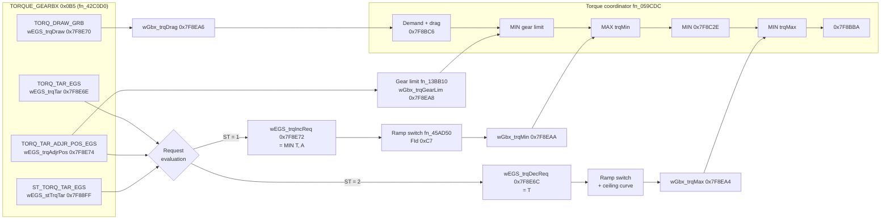

# DDE6.3: Torque intervention by the EGS via CAN (downshift blip)

Function description of the gearbox torque interface of the DDE6.3 (Bosch EDC16CP35, program `7808738A`, data `T7808736`), written in the style of the Bosch EDC15C description, sections 3.1.8.3 "ASR intervention via CAN" and 3.1.8.4 "MSR intervention via CAN" ([EDC15C function description](../../Shared/Documentation/EDC15C-Function-Description/en/03-Fuel-Quantity-Control.md)). Like ASR/MSR, the EGS sends a torque request via CAN and the DDE checks it for validity, prepares it and passes it to the torque coordinator. The difference is that the DDE6.3 works in torque (Nm), not in fuel quantity, and accepts both a reducing and an **increasing** request. The increasing request is the downshift blip.

Everything below comes from the static analysis in [README.md](README.md#gearbox-torque-interface-torque_gearbx-0x0b5).

> **Names.** The firmware contains no Bosch labels for these variables. CAN signal names are BMW's (`TORQ_TAR_EGS`, ...). All other names are **working names** introduced here (prefix `w`), each with its RAM or calibration address. Torques are signed 16-bit values in 0.1 Nm unless noted otherwise.

## Overview

The transmission control unit (GS19.11 for the M67D44) sends the message `TORQUE_GEARBX` (ID 0x0B5) every 10 ms. Besides the drag torque and the gearbox temperature, it carries a torque target `TORQ_TAR_EGS` and a status `ST_TORQ_TAR_EGS`, which says what the target means:

| `ST_TORQ_TAR_EGS` | Meaning | Effect in the DDE |
|---|---|---|
| 0 | No intervention | none |
| 1 | Increase torque | `TORQ_TAR_EGS` becomes a **minimum torque** (positive intervention, downshift blip) |
| 2 | Decrease torque | `TORQ_TAR_EGS` becomes a **maximum torque** (shift torque reduction) |
| 3 | Invalid | none |

The DDE has no calibration of its own for the size, shape or duration of the blip. The EGS decides all of this by setting `ST_TORQ_TAR_EGS` = 1 and the target torque for as long as it wants the blip. The DDE applies the request without a ramp or filter. A ramp is only used when the DDE itself enables or withdraws the function.



Figure 1: Torque intervention by the EGS via CAN (working names)

## Receiving TORQUE_GEARBX

The PT-CAN receive task `fn_42C0D0` reads the message from receive record 1 (bus 0, object 12, DLC 8). The scaling parameters are in the receive calibration block `wCAN_GbxPar` = 0x0DB5EC.

| CAN message: TORQUE_GEARBX | | Identifier: 0B5H | | | | |
|---|---|---|---|---|---|---|
| Signal label | Signal designation | Bit addr. | Bit count | Default | Invalid | RAM (working name) |
| `CHKSM_TORQ_EGS` | Checksum | 0 | 8 | | | checked, fault path 0xC3 |
| `ALIV_TORQ_EGS` | Alive counter | 8 | 4 | | | checked, fault path 0xC3 |
| `TORQ_TAR_EGS` | Torque target, 0.5 Nm/bit, signed | 12 | 12 | -3276.8 Nm | 800H | 0x7F8E6E `wEGS_trqTar` |
| `TORQ_TAR_ADJR_POS_EGS` | Torque target for positive intervention, 0.5 Nm/bit | 24 | 12 | 1000 Nm | 800H | 0x7F8E74 `wEGS_trqAdjrPos` |
| `ST_TORQ_TAR_EGS` | Status of the torque target | 36 | 2 | | 3 | 0x7F88FF `wEGS_stTrqTar` |
| `ST_OBD_GRB` | OBD request (MIL) | 40 | 4 | | | MIL paths 0xBE/0xBF |
| `ST_LIM_STORQ` | Start-up torque limitation | 46 | 2 | | | 0x7F8901 `wEGS_stLimSTrq` |
| `TORQ_DRAW_GRB` | Gearbox drag torque, 1 Nm/bit | 48 | 8 | | | 0x7F8E70 `wEGS_trqDraw` (negated) |
| `TEMP_GRB` | Gearbox temperature, 1 °C, offset -40 | 56 | 8 | | | 0x7F8E4A, fault path 0x1EA |

The torque targets are converted to 0.1 Nm as raw × 5000/1000 (`wCAN_GbxPar+0x34`).

## Request evaluation

The request evaluation (0x42FBA0-0x42FC84) only runs if the positive-intervention path is enabled (`wCAN_GbxPar+0x389` = 1, set in all three data files).

An intervention request is only recognised as valid if all of these hold:

- `TORQ_TAR_EGS` and `TORQ_TAR_ADJR_POS_EGS` are not invalid (raw ≠ 800H),
- `TORQ_TAR_ADJR_POS_EGS` differs from its default value `wCAN_GbxPar+0x3FA` (1000 Nm),
- `ST_TORQ_TAR_EGS` = 1 or 2.

So the EGS can only activate the intervention by also sending a real `TORQ_TAR_ADJR_POS_EGS`. In the GS19.11 data, the constant 0x071A62 = 2000 (× 0.5 Nm = 1000 Nm) for both diesels is a candidate for this default value.

For a valid request:

*wEGS_trqIncReq* (0x7F8E72) = MIN(*wEGS_trqTar*, *wEGS_trqAdjrPos*) if `ST_TORQ_TAR_EGS` = 1, otherwise -3276.8 Nm (no request)

*wEGS_trqDecReq* (0x7F8E6C) = *wEGS_trqTar* if `ST_TORQ_TAR_EGS` = 2, otherwise 3276.7 Nm (no request)

*wEGS_trqAdjrPos* is also kept as an upper limit for the gear limit (see below).

## Preparation of the increase request (minimum torque)

`fn_13BF80` prepares the minimum torque *wGbx_trqMin* (0x7F8EAA) from *wEGS_trqIncReq*. Its parameters are in the calibration block `wGbxIf_Par` = 0x0DBD14.

1. If `wGbxIf_Par+0x00` = 1, the RAM value 0x7F989C is subtracted first. This value is written by `fn_41A964`/`fn_41B274`/`fn_41B4F8` and hasn't been identified.
2. The result is limited to the maximum `wGbxIf_Par+0x50` (32767 = 3276.7 Nm, so no cap in this calibration).
3. The value then goes through the ramp switch `fn_45AD50`, controlled by the function-inhibit permission **FId 0xC7** (bit 0 of 0x6F8565 in the function-inhibit array 0x6F849E).

**Behaviour while permitted:** the request passes through unchanged, so every change the EGS makes takes effect in the same 20 ms cycle. When the EGS ends the request (`ST_TORQ_TAR_EGS` ≠ 1), *wGbx_trqMin* jumps straight to "no request". Like the MSR intervention ending with *mroMD_MSR* = 0, the blip is switched off abruptly without a ramp, and the EGS controls the shape of the falling edge.

**Switch-on and switch-off behaviour:** only when the permission FId 0xC7 changes does the output ramp between the request and the fallback value `wGbxIf_Par+0x52` (-32768 = no request), with the slopes `wGbxIf_Par+0x54` (0x00050000 = 10 Nm per 20 ms, 500 Nm/s). This prevents a torque jump when the DDE inhibits or re-enables the function while a request is active.

At initialisation *wGbx_trqMin* is set to -500 Nm.

## Preparation of the reduction request (maximum torque)

The reduction request *wEGS_trqDecReq* is handled the same way and gives *wGbx_trqMax* (0x7F8EA4), with slopes `wGbxIf_Par+0x48`. It is additionally limited by a ceiling: `wGbxIf_Par+0x02` (3276.7 Nm) if the RAM value 0x7F9324 is above the threshold `wGbxIf_Par+0x5C`, otherwise the curve `wGbxIf_Par+0x04` over 0x7F98C4 (200-6000, all 1000 Nm). At initialisation *wGbx_trqMax* is set to 1000 Nm.

## Gear-dependent torque limit

`fn_13BB10` forms the gear limit *wGbx_trqGearLim* (0x7F8EA8) as the minimum of:

- the per-gear curve over 0x7F98C4 (most likely engine speed), selected by the gear 0x7F890D (-1 to 6),
- *wEGS_trqAdjrPos*,
- the start-up limitation, if `ST_LIM_STORQ` requests it.

| Gear | Curve (block `wGbxLim_Par` = 0x0DBD74) | Value |
|---|---|---|
| R | 0x0DC04A | 400 Nm |
| 1-6 | 0x0DBED6, 0x0DBF14, 0x0DBF52, 0x0DBF90, 0x0DBFCE, 0x0DC00C | 750 Nm |
| N / other | 0x0DBDA4 | 700 Nm |

All curves are flat and identical in the 220 kW and 242 kW data.

## Gearbox drag torque

*wGbx_trqDrag* (0x7F8EA6) = *wEGS_trqDraw* if 0x7F8910 = 1, otherwise 0. The torque coordinator adds it to the demand, so the engine also covers the gearbox drag torque the EGS reports.

## Torque coordinator

The torque coordinator `fn_059CDC` (0x059D34-0x059D84) combines the demand with the gearbox interventions in a fixed order:

```text
x = driver/vehicle demand corrected by wGbx_trqDrag        (0x7F8BC6)
x = MIN(x, wGbx_trqGearLim)     gear limit, TORQ_TAR_ADJR_POS_EGS, start-up limit
x = MAX(x, wGbx_trqMin)         EGS increase request (downshift blip)
x = MIN(x, 0x7F8C2E)            further limit (written in fn_058FA8, not identified)
x = MIN(x, wGbx_trqMax)         EGS reduction request
-> 0x7F8BBA;  0x7F8BBE = 0x7F8BBA + 0x7F8BB0
```

**Priority.** The increase request comes after the gear limit. So, in the calculation algorithm, the EGS increase request has priority over the per-gear limit: a blip can exceed 750 Nm, because the per-gear curve limits only the driver demand. The increase request is limited only by:

- *wEGS_trqAdjrPos* (the minimum in the request evaluation),
- the cap `wGbxIf_Par+0x50` (open in this calibration),
- the further limit 0x7F8C2E,
- an active reduction request *wGbx_trqMax*, which has the highest priority.

The resulting torque is converted to fuel quantity downstream, where the smoke and component-protection limits still apply.

The DDE5.1 (`fn_85D864`, 0x85D8BC-0x85D8F8) uses exactly the same order.

## Driveability (gradient limitation)

The routine at 0x059564 ranks the active intervention into the bit word 0x7F932C (code 5 = EGS increase, code 6 = EGS reduction). Two driveability mode selectors, `fn_064664` (calibration 0x0C8FB8) and `fn_40D35C`, check "external intervention active" (bits 3-6) first and switch to a dedicated mode. In that mode `fn_064664` loads the torque gradient limits 0x7F9360-0x7F9366 from `+0x22`/`+0x24`. These are 32767 (unlimited) in this calibration, so the blip is not slowed down by the driveability rate limiter.

| 0x7F932C | Meaning |
|---|---|
| Bit 5 | EGS increase request (minimum torque) active |
| Bit 6 | EGS reduction request (maximum torque) active |
| Bits 3-6 | External intervention active (condition for the driveability mode) |

## Feedback to the EGS

`fn_4313F8` builds the engine torque signals sent to the EGS and the other control units (CAN records 3-5, messages 0x0A8-0x0AA). It has an option to include the increase request in the transmitted value, but that option is switched off in this calibration (`wCAN_GbxPar+0x37F` = 0). The transmitted value is only clamped at -500 Nm.

## Fault handling

| Fault | Detection | Reaction |
|---|---|---|
| Message `TORQUE_GEARBX` missing, checksum or alive counter wrong | Error word 0x7F8E36 | Fault path 0xC3 = **4DF0-4DF3**. The signals fall back to their defaults (`TORQ_TAR_EGS` -3276.8 Nm, `TORQ_TAR_ADJR_POS_EGS` 1000 Nm). Because the default 1000 Nm makes the request invalid, the intervention ends abruptly with no request |
| Signal invalid (raw 800H) or `ST_TORQ_TAR_EGS` = 3 | Request evaluation | No request (as above) |
| Gearbox temperature invalid | `TEMP_GRB` | Fault path 0x1EA = 41B5 |
| MIL request from the EGS | `ST_OBD_GRB` 0/2/4/6/12 | Fault paths 0xBE (3F05 "MIL OFF") / 0xBF (3F15 "MIL On") |
| Function inhibited | FId 0xC7 withdrawn | *wGbx_trqMin* ramps to "no request" at 10 Nm per 20 ms |

## Messages

*wEGS_trqTar* (0x7F8E6E): `TORQ_TAR_EGS`, torque target of the EGS

*wEGS_trqAdjrPos* (0x7F8E74): `TORQ_TAR_ADJR_POS_EGS`, upper limit for the positive intervention

*wEGS_stTrqTar* (0x7F88FF): `ST_TORQ_TAR_EGS`, meaning of the torque target

*wEGS_trqDraw* (0x7F8E70): `TORQ_DRAW_GRB`, gearbox drag torque (negated)

*wEGS_stLimSTrq* (0x7F8901): `ST_LIM_STORQ`, start-up torque limitation

*wEGS_trqIncReq* (0x7F8E72): Valid increase request

*wEGS_trqDecReq* (0x7F8E6C): Valid reduction request

*wGbx_trqMin* (0x7F8EAA): Gearbox minimum torque after the ramp switch (blip)

*wGbx_trqMax* (0x7F8EA4): Gearbox maximum torque after the ramp switch and ceiling

*wGbx_trqGearLim* (0x7F8EA8): Gear-dependent maximum torque

*wGbx_trqDrag* (0x7F8EA6): Drag torque used by the coordinator

0x7F890D: Current gear (-1 = R, 0 = N, 1-6)

0x7F8BC6 / 0x7F8BBA / 0x7F8BBE: Coordinator input / output / output plus 0x7F8BB0

0x7F932C: Active intervention bit word

## Parameters

| Parameter | Address | Value (`T7808736`) | Meaning |
|---|---|---|---|
| `wCAN_GbxPar+0x34` | 0x0DB620 | offset 0, factor 5000 | Scaling of the torque targets (0.5 Nm → 0.1 Nm) |
| `wCAN_GbxPar+0x37F` | 0x0DB96B | 0 | Include the increase request in the transmitted engine torque |
| `wCAN_GbxPar+0x389` | 0x0DB975 | 1 | Enable the positive-intervention path |
| `wCAN_GbxPar+0x3FA` | 0x0DB9E6 | 10000 (1000 Nm) | Default value of `TORQ_TAR_ADJR_POS_EGS` (= no request) |
| `wGbxIf_Par+0x00` | 0x0DBD14 | 1 | Subtract 0x7F989C from the increase request |
| `wGbxIf_Par+0x02` | 0x0DBD16 | 32767 | Reduction ceiling above the threshold `+0x5C` |
| `wGbxIf_Par+0x04` | 0x0DBD18 | curve, 1000 Nm | Reduction ceiling over 0x7F98C4 |
| `wGbxIf_Par+0x48` | 0x0DBD5C | 0x00050000 | Ramp slopes of the reduction request (10 Nm per 20 ms) |
| `wGbxIf_Par+0x50` | 0x0DBD64 | 32767 | Cap of the increase request (open) |
| `wGbxIf_Par+0x52` | 0x0DBD66 | -32768 | Fallback value of the increase request (no request) |
| `wGbxIf_Par+0x54` | 0x0DBD68 | 0x00050000 | Ramp slopes of the increase request (10 Nm per 20 ms) |
| `wGbxLim_Par` curves | 0x0DBDA4-0x0DC04A | 400 / 700 / 750 Nm | Per-gear torque limit (limits the demand, not the blip) |
| Driveability `+0x22`/`+0x24` | 0x0C8FDA / 0x0C8FDC | 32767 | Torque gradient limits during an external intervention (unlimited) |
| FId 0xC7 | 0x6F8565 bit 0 | | Function-inhibit permission for the increase request |

## Remarks

- The blip parameters (target torque, duration, which shifts) are entirely in the EGS. The GS19.11 code is encrypted, so they haven't been identified (see [M67-DDE63-Findings.md](../M67-DDE63-Findings.md#transmission-side-gs1911-calibration-m67d44)).
- Open points on the DDE side: the value 0x7F989C subtracted from the increase request, the further limit 0x7F8C2E, and the conditions that withdraw FId 0xC7.
- To verify on the car, log 0x0B5 during a manual downshift and look for `ST_TORQ_TAR_EGS` = 1 together with the engine torque messages 0x0A8-0x0AA.
